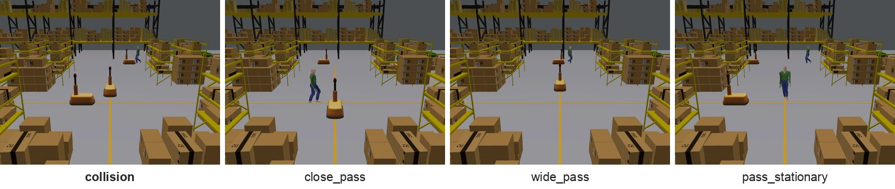
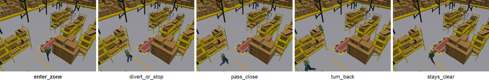
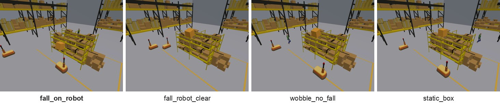

# MCWS: Multi-Camera Warehouse Safety Dataset

**Paper:** TBD | **[Download](#download)** | [](https://creativecommons.org/licenses/by/4.0/)

<p align="center"></p>
<p align="center"><em>One moment of an episode from each task, seen by the four cameras.</em></p>

**At a glance**

| | |
| --- | --- |
| Episodes | 5000 |
| Videos | 20000 |
| Cameras | 4 static, calibrated |
| Tasks | 3 (`collision`, `intrusion`, `dropped_box`) |
| Resolution | 1280 x 960 |
| Frame rate | 20 fps |
| Video length | 15 s |
| Total video duration | 83.3 h |
| Size | about 14 GB |
| License | CC BY 4.0 |

MCWS is a synthetic video dataset for anticipating safety events in a warehouse. Each episode is a 15 s scene
rendered in a simulated warehouse with Gazebo and recorded by four static cameras whose positions, orientations
and fields of view are known. The dataset has three tasks:

- `collision`: two agents (two mobile robots, or a mobile robot and a person) on crossing paths.
- `intrusion`: a person walks near a hazardous zone.
- `dropped_box`: a box on a high shelf next to the lane of a mobile robot.

Every episode comes with `target_event` (1 if the task's target event occurs in the episode), a scene category,
and per-time labels at 31 decision times that say whether the target event is predicted within the next 4 s. The
target event is a collision between the two agents (`collision`), the person entering the hazardous zone
(`intrusion`), or the box falling onto the robot (`dropped_box`).

In total the dataset has 5000 episodes and 20000 videos.

<p align="center">
    
</p>
<p align="center"><em>Positive episodes of collision, intrusion and dropped box (one camera each, 7 to 12 s).</em></p>

## Contents

- [Download](#download)
- [Episodes per task, category and split](#episodes-per-task-category-and-split)
- [Videos](#videos)
- [Folder layout](#folder-layout)
- [episodes.csv](#episodescsv)
- [labels.csv](#labelscsv)
- [Tasks and categories](#tasks-and-categories)
- [cameras.json](#camerasjson)
- [Splits](#splits)
- [Loading example](#loading-example)
- [Evaluation](#evaluation)
- [License](#license)
- [Acknowledgements and third-party assets](#acknowledgements-and-third-party-assets)
- [Citation](#citation)
- [Contact](#contact)

## Download

The videos (about 14 GB) will be available for download soon. This repository holds the documentation.

## Episodes per task, category and split

### collision

| category | target_event | train | val | test | total |
| --- | --- | ---: | ---: | ---: | ---: |
| `collision` | 1 | 250 | 150 | 100 | 500 |
| `close_pass` | 0 | 125 | 75 | 50 | 250 |
| `wide_pass` | 0 | 125 | 75 | 50 | 250 |
| `pass_stationary` | 0 | 125 | 75 | 50 | 250 |
| **total** |  | 625 | 375 | 250 | 1250 |

### intrusion

| category | target_event | train | val | test | total |
| --- | --- | ---: | ---: | ---: | ---: |
| `enter_zone` | 1 | 250 | 150 | 100 | 500 |
| `divert_or_stop` | 0 | 125 | 75 | 50 | 250 |
| `pass_close` | 0 | 125 | 75 | 50 | 250 |
| `turn_back` | 0 | 125 | 75 | 50 | 250 |
| `stays_clear` | 0 | 250 | 150 | 100 | 500 |
| **total** |  | 875 | 525 | 350 | 1750 |

### dropped_box

| category | target_event | train | val | test | total |
| --- | --- | ---: | ---: | ---: | ---: |
| `fall_on_robot` | 1 | 250 | 150 | 100 | 500 |
| `fall_robot_clear` | 0 | 250 | 150 | 100 | 500 |
| `wobble_no_fall` | 0 | 250 | 150 | 100 | 500 |
| `static_box` | 0 | 250 | 150 | 100 | 500 |
| **total** |  | 1000 | 600 | 400 | 2000 |

## Videos

- Four cameras per episode, `cam0` to `cam3`. Their placement is the same for every episode of a task and is
  given in the task's `cameras.json`.
- H.264 MP4, 1280 x 960 pixels, 20 fps, 300 frames, 15.0 s.
- The four videos of an episode are synchronized. Frame `i` (counting from 0) is shown at `i / 20` s.
- Each scene also contains background people or robots moving elsewhere in the warehouse. The labels concern only
  the agents described for each task.

## Folder layout

```
MCWS/
  README.md
  LICENSE
  checksums.sha256          SHA-256 of every other file (sha256sum format)
  docs/
    annotation.md           exact rules behind the per-time labels
  collision/
    cameras.json
    episodes.csv
    labels.csv
    videos/<episode_id>/cam0.mp4 ... cam3.mp4
  intrusion/                same layout
  dropped_box/              same layout
  splits/
    train.txt
    val.txt
    test.txt
```

## episodes.csv

One row per episode.

| column | meaning |
| --- | --- |
| `episode_id` | for example `collision_0001`; the videos are in `videos/<episode_id>/` |
| `split` | `train`, `val` or `test` |
| `target_event` | 1 if the target event occurs in the episode, 0 otherwise |
| `category` | scene category, see [Tasks and categories](#tasks-and-categories) |

## labels.csv

One row per episode and decision time: 31 rows per episode, at decision times 5.95 s to 8.95 s in steps of 0.1 s
(frames 119, 121, ..., 179).

| column | meaning |
| --- | --- |
| `episode_id` | the episode, as in `episodes.csv` |
| `frame` | decision frame: the last frame a model may use for this decision (frames 0 to `frame`) |
| `time_s` | time of the decision frame in seconds, `frame / 20` |
| `label` | whether the target event is predicted within the next 4 s: 1, 0 or -1 |

- `1`: the target event is predicted within the next 4 s if every agent keeps its current velocity.
- `0`: the target event is not predicted, with a safety margin.
- `-1`: a boundary case between the two. Ignore these rows in training and evaluation.

The exact rules are in [docs/annotation.md](docs/annotation.md).

Per-time labels describe what can be predicted at that moment, not the final outcome, so they can be 1 in an
episode whose `target_event` is 0. A person walking straight at the zone is labeled 1 until the turn away shows in their
velocity, and a creeping box is labeled 1 while a robot is heading into its fall area, even if the box never falls.

## Tasks and categories

### collision



Two agents, either two mobile robots or a mobile robot and a person, are on crossing paths.

**Target event:** a collision between the two agents.

| category | target_event | what happens |
| --- | --- | --- |
| `collision` | 1 | The two agents touch. In half of these episodes one robot starts from rest 1 to 5 s before the contact. |
| `close_pass` | 0 | Both agents move and pass each other with a closest gap of 0.30 to 1.00 m. |
| `wide_pass` | 0 | Both agents move and pass each other with a closest gap of 1.25 to 2.50 m. |
| `pass_stationary` | 0 | A robot stays still a short distance before the crossing point for the whole episode, and the other agent passes it with a closest gap of 0.7 to 2.5 m. |

**Per-time label:** 1 if the two agents would touch within the next 4 s at their current velocities ([details](docs/annotation.md#collision)).

### intrusion



A person walks near a hazardous zone on a corridor, close to the point where a cross aisle meets the corridor.

**Target event:** the person entering the hazardous zone.

| category | target_event | what happens |
| --- | --- | --- |
| `enter_zone` | 1 | The person walks into the zone, either straight along the corridor or by turning in from the cross aisle. |
| `divert_or_stop` | 0 | The person walks along the corridor toward the zone, then turns into the cross aisle before reaching it, or slows down and stops 1 to 3 m short of it. |
| `pass_close` | 0 | The person walks toward the zone, comes within about 1 m of its edge, then veers away. |
| `turn_back` | 0 | The person walks toward the zone, then turns around and walks back the way they came. |
| `stays_clear` | 0 | The person never heads into the zone: they walk down the cross aisle and stop in the corridor about 1 m from the zone, or wait in the corridor and then walk away from the zone. |

**Per-time label:** 1 if the person would reach the zone within the next 4 s at their current velocity ([details](docs/annotation.md#intrusion)).

### dropped_box



A box sits on a high shelf next to the lane of a mobile robot and, if it falls, falls into the lane.

**Target event:** the box falling onto the robot.

| category | target_event | what happens |
| --- | --- | --- |
| `fall_on_robot` | 1 | The box creeps and rocks, then falls into the lane onto the robot, which is driving past or has stopped in front of the shelf. |
| `fall_robot_clear` | 0 | The box creeps, rocks and falls into the lane, but the robot stays out of the fall area: it drives in a lane farther from the shelf, moves over to that lane, or slows down and stops before the area. |
| `wobble_no_fall` | 0 | The box creeps and rocks but stays on the shelf while the robot drives past or stops in front of the shelf. |
| `static_box` | 0 | The box never moves while the robot drives past or stops in front of the shelf. |

**Per-time label:** 1 if the box is unstable and the robot would reach its fall area within the next 4 s at its current velocity ([details](docs/annotation.md#dropped_box)).

## cameras.json

One file per task with the four cameras: `id`, `position_m` (x, y, z), `yaw_rad`, `pitch_rad`, `roll_rad`,
`horizontal_fov_deg`, `resolution` (width, height) and `fps`. Positions and orientations are in the world frame
described in [docs/annotation.md](docs/annotation.md).

The camera looks along its own +x axis, with +y to the left and +z up in the image. Its orientation in the world
is the rotation R = Rz(yaw) Ry(pitch) Rx(roll), so a positive pitch tilts the camera down. The cameras are ideal
pinhole cameras without lens distortion, with square pixels and the principal point at the image centre; the
focal length in pixels is f = (width / 2) / tan(horizontal_fov / 2).

## Splits

`splits/train.txt`, `splits/val.txt` and `splits/test.txt` list episodes as `<task>/<episode_id>`, for example
`collision/collision_0001`. Episodes that share a scene setup (agent speeds, timing and background motion) are
always in the same split, so please use the splits as given.

## Loading example

```python
import json
import cv2  # pip install opencv-python
import pandas as pd

root, task = "MCWS", "collision"
episodes = pd.read_csv(f"{root}/{task}/episodes.csv")
labels = pd.read_csv(f"{root}/{task}/labels.csv")
cameras = json.load(open(f"{root}/{task}/cameras.json"))["cameras"]

ep = episodes.iloc[0]
cap = cv2.VideoCapture(f"{root}/{task}/videos/{ep.episode_id}/cam0.mp4")
frames = []
while True:
    ok, image = cap.read()
    if not ok:
        break
    frames.append(image)  # 300 frames of 960 x 1280 x 3 (BGR)

for row in labels[labels.episode_id == ep.episode_id].itertuples():
    if row.label == -1:
        continue  # boundary case, ignore
    visible = frames[: row.frame + 1]  # frames a model may use for this decision
```

## Evaluation

Evaluate each task separately on the test split and ignore the rows of `labels.csv` with label -1. A method gives
a score for each remaining row, using only frames 0 to `frame` of that episode.

- **Miss rate** at each decision time: the fraction of rows with label 1 that are predicted 0 at a chosen score
  threshold.
- **False-alarm rate** at each decision time: the fraction of rows with label 0 that are predicted 1 at the same
  threshold.
- **Average precision** of the score over the rows of all decision times.

Choose the threshold without using the test split, for example on val, and report it with the rates.

## License

MCWS is released under the Creative Commons Attribution 4.0 International License (CC BY 4.0). See `LICENSE`.

## Acknowledgements and third-party assets

The videos were rendered with Gazebo (gz-sim). The dataset contains rendered videos only; it does not include any
3D model files. The scenes use these third-party models:

- Warehouse shelves, clutter, desk, trash can, pallet jack, walls and roof: AWS RoboMaker Small Warehouse World
  models (https://github.com/aws-robotics/aws-robomaker-small-warehouse-world), MIT-0, obtained via
  https://github.com/belal-ibrahim/dynamic_logistics_warehouse.
- Walking person: Gazebo Fuel model "actor" by Mingfei (https://app.gazebosim.org/Mingfei/fuel/models/actor),
  CC BY 4.0.
- Mobile robot: Gazebo Fuel model "Warehouse Robot" by Open Robotics
  (https://app.gazebosim.org/OpenRobotics/fuel/models/Warehouse%20Robot), CC0 1.0.

## Citation

```bibtex
@misc{mcws,
  title  = {{MCWS}: Multi-Camera Warehouse Safety Dataset},
  author = {TBD},
  year   = {TBD},
  note   = {TBD}
}
```

## Contact

For questions and issues, please open an issue at https://github.com/cylinomc/MCWS/issues.
