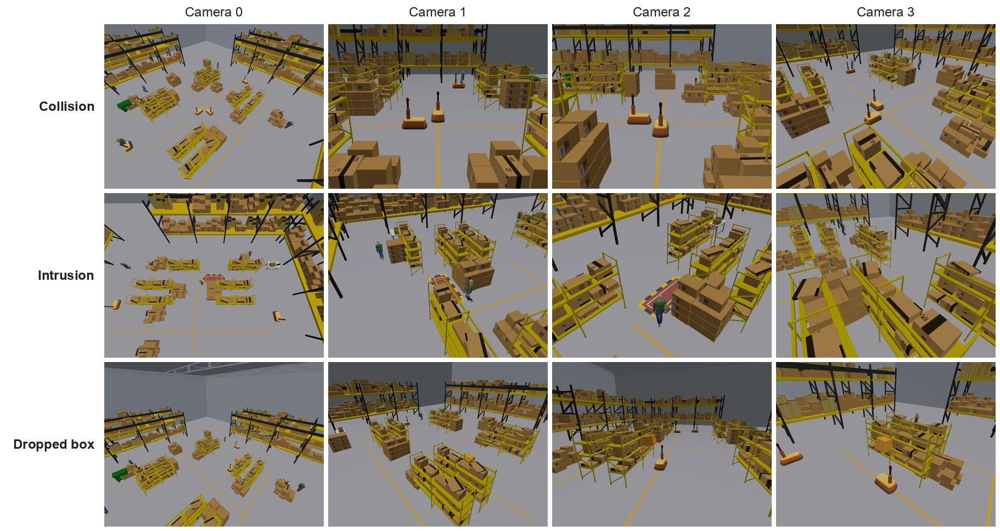
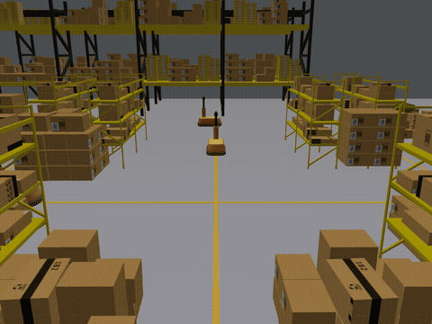
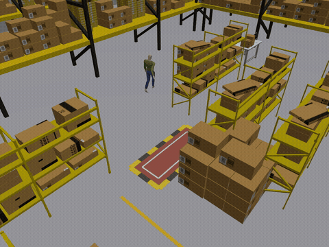
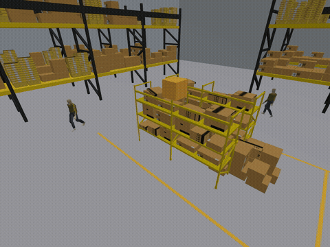

# MCWS: Multi-Camera Warehouse Safety Dataset

**Paper:** TBD | **[Download](#download)** | [](https://creativecommons.org/licenses/by/4.0/)

<p align="center"></p>
<p align="center"><em>One moment of an episode from each task, seen by the four cameras.</em></p>

**At a glance**

| | |
| --- | --- |
| Episodes | 5000 |
| Videos | 20000 |
| Cameras | 4 static, calibrated |
| Tasks | 3 (`collision`, `intrusion`, `dropped_box`) |
| Resolution | 1280 x 960 |
| Frame rate | 20 fps |
| Video length | 15 s |
| Total video duration | 83.3 h |
| Size | about 14 GB |
| License | CC BY 4.0 |

MCWS is a synthetic video dataset of safety events in a warehouse. Each episode is a 15 s scene rendered in a
simulated warehouse with Gazebo and recorded by four static cameras whose positions, orientations and fields of
view are known. The dataset has 3 tasks:

- `collision`: Two agents, either two mobile robots or a mobile robot and a person, are on crossing paths.
- `intrusion`: A person walks near a hazardous zone on a corridor, close to the point where a cross aisle meets the corridor.
- `dropped_box`: A box sits on a high shelf next to the lane of a mobile robot and, if it falls, falls into the lane.

Each task has one target event. Every episode comes with `has_event` (1 if the target event occurs in the
episode), `event_frame` (the frame at which it happens), a scene category, and an example label for every
frame, `risk_4s`.

In total the dataset has 5000 episodes and 20000 videos.

<p align="center">
    
</p>
<p align="center"><em>Positive episodes of collision, intrusion and dropped box (one camera each, 7 to 12 s).</em></p>

## Contents

- [Download](#download)
- [Tasks and categories](#tasks-and-categories)
- [Data format](#data-format)
- [Getting started](#getting-started)
- [License and acknowledgements](#license-and-acknowledgements)
- [Citation and contact](#citation-and-contact)

## Download

The videos (about 14 GB) will be available for download soon. This repository holds the documentation.

## Tasks and categories

| Task | Target event | Categories | Episodes | Details |
| --- | --- | --- | ---: | --- |
| Collision | A collision between the two agents | `collision`, `close_pass`, `wide_pass`, `pass_stationary` | 1250 | [docs/tasks/collision.md](docs/tasks/collision.md) |
| Intrusion | The person entering the hazardous zone | `enter_zone`, `divert_or_stop`, `pass_close`, `turn_back`, `stays_clear` | 1750 | [docs/tasks/intrusion.md](docs/tasks/intrusion.md) |
| Dropped box | The box falling onto the robot | `fall_on_robot`, `fall_robot_clear`, `wobble_no_fall`, `static_box` | 2000 | [docs/tasks/dropped_box.md](docs/tasks/dropped_box.md) |

The first category of each task is the one with the target event (`has_event` = 1). Each task page shows the
categories, the episodes per split, the moment of the target event and the labeling rule.

## Data format

### Videos

- Four cameras per episode, `cam0` to `cam3`. Their placement is the same for every episode of a task and is
  given in the task's `cameras.json`.
- H.264 MP4, 1280 x 960 pixels, 20 fps, 300 frames, 15.0 s.
- The four videos of an episode are synchronized. Frame `i` (counting from 0) is shown at `i / 20` s.
- Each scene also contains background people or robots moving elsewhere in the warehouse. The labels concern only
  the agents described for each task.

### Folder layout

```
MCWS/
  README.md
  LICENSE
  docs/
    tasks/<task>.md         categories, episodes per split and labeling rule of each task
  <task>/                   one folder per task: collision, intrusion, dropped_box
    cameras.json
    episodes.csv
    labels.csv
    videos/<episode_id>/cam0.mp4 ... cam3.mp4
  splits/
    train.txt
    val.txt
    test.txt
```

### Episode list (`episodes.csv`)

One row per episode.

| Column | Description |
| --- | --- |
| `episode_id` | For example `collision_0001`; the videos are in `videos/<episode_id>/` |
| `split` | `train`, `val` or `test` |
| `has_event` | 1 if the target event occurs in the episode, 0 otherwise |
| `category` | Scene category, see [Tasks and categories](#tasks-and-categories) |
| `event_frame` | Index (0-based) of the first frame at or after the moment of the target event; empty if `has_event` is 0 |

The moment of the target event of each task is defined on its page in [docs/tasks](docs/tasks).

### Labels (`labels.csv`)

One row per frame: 300 rows per episode, frames 0 to 299.

| Column | Description |
| --- | --- |
| `episode_id` | The episode, as in `episodes.csv` |
| `frame` | Frame index (0-based) |
| `risk_4s` | 1, 0 or -1, see below |

`risk_4s` is a provided example label:

- `1`: Extrapolating the current motion, the target event happens within 4 s.
- `0`: It does not, with a safety margin.
- `-1`: Ambiguous, or not available for this frame (a few frames at the start or end of an episode, see the task
  pages).

The exact rule of each task is on its page in [docs/tasks](docs/tasks). A frame label can be 1 in an episode whose
`has_event` is 0. Other targets, for example whether the event happens within a chosen number of frames, can be
derived from `event_frame`.

### Cameras (`cameras.json`)

One file per task with the four cameras: `id`, `position_m` (x, y, z), `yaw_rad`, `pitch_rad`, `roll_rad`,
`horizontal_fov_deg`, `resolution` (width, height) and `fps`. Positions are in metres in the world frame of the
task (right-handed, z up, floor at z = 0); the task pages use the same frame.

The camera looks along its own +x axis, with +y to the left and +z up in the image. Its orientation in the world
is the rotation R = Rz(yaw) Ry(pitch) Rx(roll), so a positive pitch tilts the camera down. The cameras are ideal
pinhole cameras without lens distortion, with square pixels and the principal point at the image centre; the
focal length in pixels is f = (width / 2) / tan(horizontal_fov / 2).

### Splits

`splits/train.txt`, `splits/val.txt` and `splits/test.txt` list episodes as `<task>/<episode_id>`, for example
`collision/collision_0001`. Episodes that share a scene setup (agent speeds, timing and background motion) are always in
the same split; the splits hold 70, 10 and 20 % of the scene setups of each task. Please use the splits as given.

## Getting started

```python
import json
import cv2  # pip install opencv-python
import pandas as pd

root, task = "MCWS", "collision"
episodes = pd.read_csv(f"{root}/{task}/episodes.csv")
labels = pd.read_csv(f"{root}/{task}/labels.csv")
cameras = json.load(open(f"{root}/{task}/cameras.json"))["cameras"]

ep = episodes[episodes.has_event == 1].iloc[0]
print(ep.episode_id, ep.category, int(ep.event_frame))  # frame at which the target event happens
risk = labels[labels.episode_id == ep.episode_id].risk_4s.to_numpy()  # 300 values, one per frame

cap = cv2.VideoCapture(f"{root}/{task}/videos/{ep.episode_id}/cam0.mp4")
frames = []
while True:
    ok, image = cap.read()
    if not ok:
        break
    frames.append(image)  # 300 frames of 960 x 1280 x 3 (BGR)
```

## License and acknowledgements

MCWS is released under the Creative Commons Attribution 4.0 International License (CC BY 4.0). See `LICENSE`.

The videos were rendered with Gazebo (gz-sim). The dataset contains rendered videos only; it does not include any
3D model files. The scenes use these third-party models:

- Warehouse shelves, clutter, desk, trash can, pallet jack, walls and roof: AWS RoboMaker Small Warehouse World
  models (https://github.com/aws-robotics/aws-robomaker-small-warehouse-world), MIT-0, obtained via
  https://github.com/belal-ibrahim/dynamic_logistics_warehouse.
- Walking person: Gazebo Fuel model "actor" by Mingfei (https://app.gazebosim.org/Mingfei/fuel/models/actor),
  CC BY 4.0.
- Mobile robot: Gazebo Fuel model "Warehouse Robot" by Open Robotics
  (https://app.gazebosim.org/OpenRobotics/fuel/models/Warehouse%20Robot), CC0 1.0.

## Citation and contact

```bibtex
@misc{mcws,
  title  = {{MCWS}: Multi-Camera Warehouse Safety Dataset},
  author = {TBD},
  year   = {TBD},
  note   = {TBD}
}
```

For questions, please contact Chih-Yu Lin (cylinomc@gmail.com) or open an issue at https://github.com/cylinomc/MCWS/issues.
