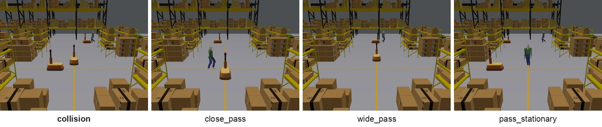

# Collision

Two agents, either two mobile robots or a mobile robot and a person, are on crossing paths.

**Target event:** a collision between the two agents.

## Categories

| Category | Target event | Description |
| --- | --- | --- |
| `collision` | 1 | The two agents touch. In half of these episodes one robot starts from rest 1 to 5 s before the contact. |
| `close_pass` | 0 | Both agents move and pass each other with a closest gap of 0.30 to 1.00 m. |
| `wide_pass` | 0 | Both agents move and pass each other with a closest gap of 1.25 to 2.50 m. |
| `pass_stationary` | 0 | A robot stays still a short distance before the crossing point for the whole episode, and the other agent passes it with a closest gap of 0.7 to 2.5 m. |

## Episodes per split

| Category | Target event | Train | Val | Test | Total |
| --- | --- | ---: | ---: | ---: | ---: |
| `collision` | 1 | 250 | 150 | 100 | 500 |
| `close_pass` | 0 | 125 | 75 | 50 | 250 |
| `wide_pass` | 0 | 125 | 75 | 50 | 250 |
| `pass_stationary` | 0 | 125 | 75 | 50 | 250 |
| **total** |  | 625 | 375 | 250 | 1250 |

## Labeling rule

A frame is labeled 1 if the two agents would touch within 4 s of the frame at their current velocities.

The velocities of the two agents over the past 0.2 s are extrapolated at constant velocity for 4 s in steps of 0.1 s. A robot is a 1.18 m x 0.68 m rectangle aligned with its heading and a person is a disc of radius 0.25 m. The label is 1 if the two footprints touch, 0 if their minimum distance stays at least 0.25 m, and -1 otherwise.
