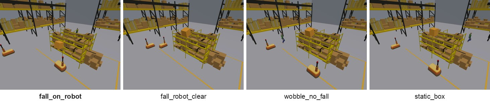

# Dropped box

A box sits on a high shelf next to the lane of a mobile robot and, if it falls, falls into the lane.

**Target event:** the box falling onto the robot.

## Categories

| Category | Target event | Description |
| --- | --- | --- |
| `fall_on_robot` | 1 | The box creeps and rocks, then falls into the lane onto the robot, which is driving past or has stopped in front of the shelf. |
| `fall_robot_clear` | 0 | The box creeps, rocks and falls into the lane, but the robot stays out of the fall area: it drives in a lane farther from the shelf, moves over to that lane, or slows down and stops before the area. |
| `wobble_no_fall` | 0 | The box creeps and rocks but stays on the shelf while the robot drives past or stops in front of the shelf. |
| `static_box` | 0 | The box never moves while the robot drives past or stops in front of the shelf. |

## Episodes per split

| Category | Target event | Train | Val | Test | Total |
| --- | --- | ---: | ---: | ---: | ---: |
| `fall_on_robot` | 1 | 250 | 150 | 100 | 500 |
| `fall_robot_clear` | 0 | 250 | 150 | 100 | 500 |
| `wobble_no_fall` | 0 | 250 | 150 | 100 | 500 |
| `static_box` | 0 | 250 | 150 | 100 | 500 |
| **total** |  | 1000 | 600 | 400 | 2000 |

## Labeling rule

A frame is labeled 1 if the box is unstable and the robot would reach its fall area within 4 s of the frame at its current velocity.

The box starts on a high shelf at (x, y, z) = (4.5, -2.95, 2.92) m, next to the lane of the robot along y = -1.8 m. When the box falls, it falls toward +y into the lane.

The box is unstable if it is still on the shelf (height at least 2.0 m), has moved at least 2 cm toward +y since the start of the episode, and has moved at least 3 mm toward +y in the last 0.25 s. It is stable if it has moved at most 1 cm in total or at most 1 mm in the last 0.25 s. The fall area is a rectangle that extends 0.525 m on each side of the box along x, and along y from 0.275 m behind the box to as far in front of it as the box is high above the floor. The robot, a 1.18 m x 0.68 m rectangle aligned with its direction of travel, is extrapolated with its velocity over the past 0.2 s for 4 s in steps of 0.1 s; it enters the fall area if its footprint touches the area, and it stays clear if its minimum distance to the area is at least 0.25 m. The label is 1 if the box is unstable and the robot enters the fall area, 0 if the box is stable or the robot stays clear (with neither the box nor the robot in between these cases), and -1 otherwise.

Coordinates are in metres in the world frame described in the [README](../../README.md#cameras-camerasjson).
