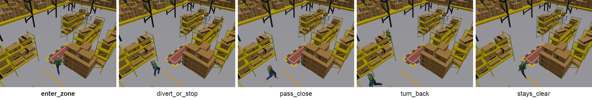

# Intrusion

A person walks near a hazardous zone on a corridor, close to the point where a cross aisle meets the corridor.

**Target event:** the person entering the hazardous zone.

## Categories

| Category | Has event | Description |
| --- | --- | --- |
| `enter_zone` | 1 | The person walks into the zone, either straight along the corridor or by turning in from the cross aisle. |
| `divert_or_stop` | 0 | The person walks along the corridor toward the zone, then turns into the cross aisle before reaching it, or slows down and stops 1 to 3 m short of it. |
| `pass_close` | 0 | The person walks toward the zone, comes within about 1 m of its edge, then veers away. |
| `turn_back` | 0 | The person walks toward the zone, then turns around and walks back the way they came. |
| `stays_clear` | 0 | The person never heads into the zone: they walk down the cross aisle and stop in the corridor about 1 m from the zone, or wait in the corridor and then walk away from the zone. |

## Episodes per split

| Category | Has event | Train | Val | Test | Total |
| --- | --- | ---: | ---: | ---: | ---: |
| `enter_zone` | 1 | 350 | 50 | 100 | 500 |
| `divert_or_stop` | 0 | 175 | 25 | 50 | 250 |
| `pass_close` | 0 | 175 | 25 | 50 | 250 |
| `turn_back` | 0 | 175 | 25 | 50 | 250 |
| `stays_clear` | 0 | 350 | 50 | 100 | 500 |
| **total** |  | 1225 | 175 | 350 | 1750 |

## Event frame

`event_frame` is the first frame at or after the first contact of the person's footprint (disc of radius 0.25 m) with the zone.

## Labeling rule

risk_4s is 1 if, extrapolating the current motion, the person reaches the zone within 4 s.

The hazardous zone is the rectangle x in [-3.7, -0.9] m, y in [-6.9, -5.7] m. The zone lies on a corridor along y = -6.3 m that is crossed by an aisle along x = 0.1 m.

The person's velocity over the past 0.2 s is extrapolated at constant velocity for 4 s in steps of 0.1 s. The person is a disc of radius 0.25 m. The label is 1 if the disc touches the zone, 0 if its minimum distance to the zone stays at least 0.25 m, and -1 otherwise.

Coordinates are in metres in the world frame described in the [README](../../README.md#cameras-camerasjson).

risk_4s is -1 at frames 0 to 3 and 299 of every episode, because the simulator poses the rule needs (at the frame and 0.2 s before it) are not available there.
